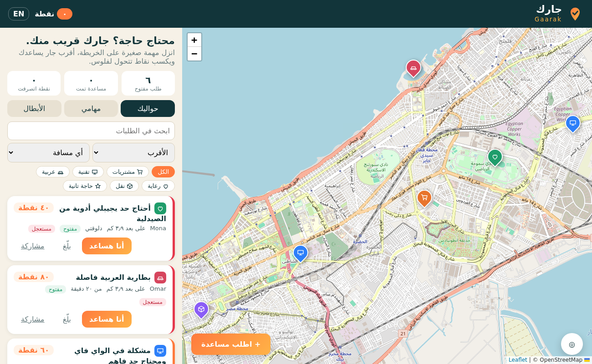
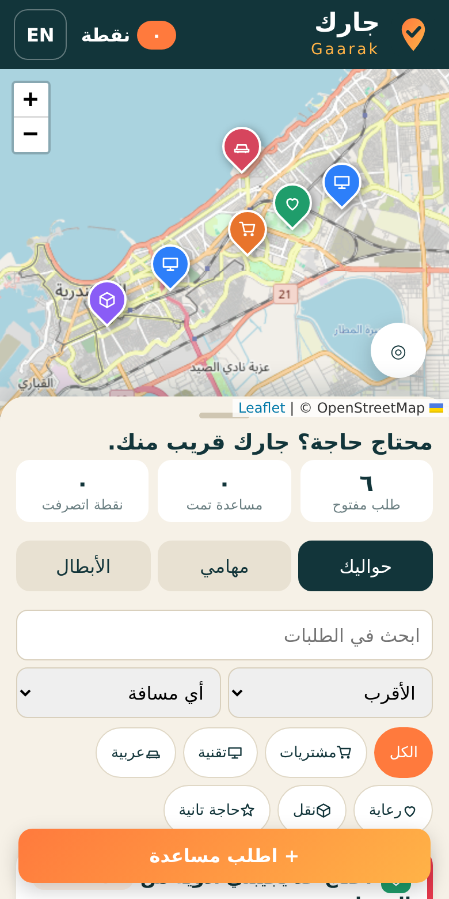
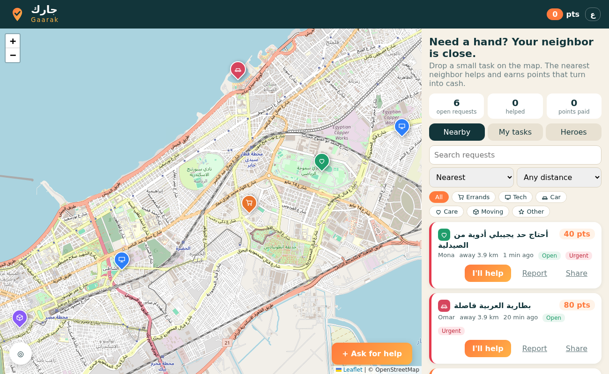
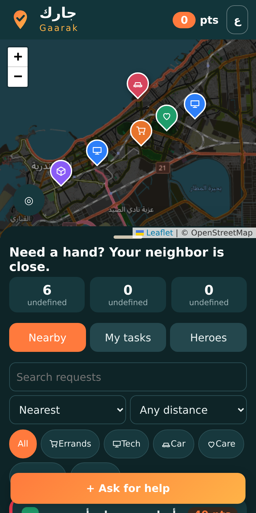
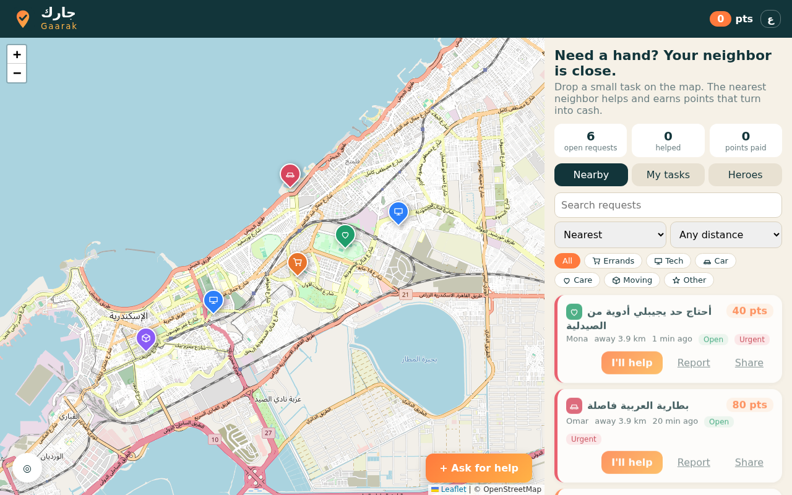
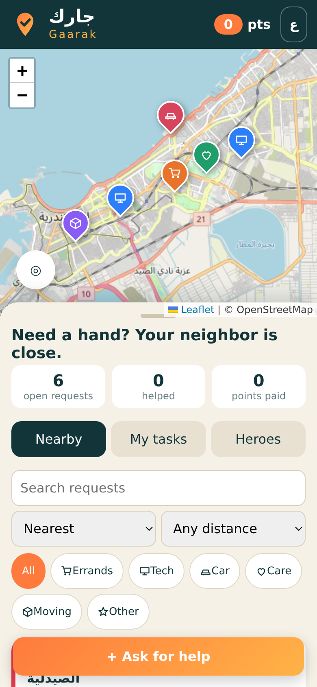

<div align="center">


# جارك | Gaarak

**A neighborhood help map. Post a small task, the nearest neighbor helps, and earns points.**

[**Live demo**](https://yousefkhames.github.io/gaarak/) · Arabic (Egyptian) + English · RTL · dark mode · installable PWA

</div>

<p align="center">
  
  
</p>
<p align="center">
  
  
</p>

## Screenshots

Captured from the live site (https://yousefkhames.github.io/gaarak/).

<p>
  
  
</p>

## What it does

Someone needs a hand: medicine from the pharmacy, a dead car battery, help with Wi-Fi. They tap the map, describe the task and set a reward in points. Neighbors see requests sorted by urgency and distance, accept one, finish it and collect points that convert to cash.

## Features

- Live map (OpenStreetMap + Leaflet) with colored category pins and a locate-me button
- Post a request in three taps: place on map, title and details, reward, urgent flag
- Search, sort (nearest, top reward, newest), radius filter and category chips
- Accept, mark done, rate the helper, cancel your own request, report and hide a request
- Points wallet with balance in EGP, simulated withdrawal (Vodafone Cash, InstaPay, Fawry) and history
- Heroes leaderboard and a stats strip
- Share a link that opens straight on a request (`#r=id`)
- Arabic (Egyptian wording, Arabic-Indic digits, relative time) and English, full RTL support
- Dark mode, mobile bottom-sheet layout, 44px touch targets, installable PWA with offline cache
- Accessibility: skip link, ARIA labels and live regions, visible focus, keyboard use, reduced-motion support

## Tech stack

| Layer | Choice |
| --- | --- |
| Frontend | Vanilla JavaScript, CSS, Leaflet, OpenStreetMap tiles |
| Backend | Zero-dependency Node.js REST server, JSON file store |
| Hosting | GitHub Pages (static, serves `/docs`) |
| Tests | Puppeteer click-through suite in `tests/qa.js` (desktop and mobile, Arabic and English) |

## Run it

```bash
git clone https://github.com/yousefkhames/gaarak.git
cd gaarak
npm start            # http://localhost:3000 with the live API
```

Static only: open `public/index.html` through any static server. Without the API the app uses a localStorage demo store seeded with sample requests around Alexandria.

API: `GET /api/requests`, `POST /api/requests`, `POST /api/requests/:id/accept`, `POST /api/requests/:id/done`, `POST /api/requests/:id/rate`, `DELETE /api/requests/:id`.

Tests: `npm i puppeteer-core`, serve `public/` on port 8123, then `node tests/qa.js` (needs Google Chrome at `/usr/bin/google-chrome`).

## Honest limits

- The hosted demo runs in localStorage mode, so requests are not shared between visitors. The Node backend exists but is not hosted for free.
- Withdrawals are simulated. No real money moves.
- No login, identity checks or moderation yet. A real launch needs auth, abuse reporting on the server and a payments partner.
- Sample requests are fictional.

## Roadmap

Accounts and phone verification, a hosted shared backend, real-time updates, chat between requester and helper, server-side moderation, real payouts.

## License

MIT. Map data © OpenStreetMap contributors.
